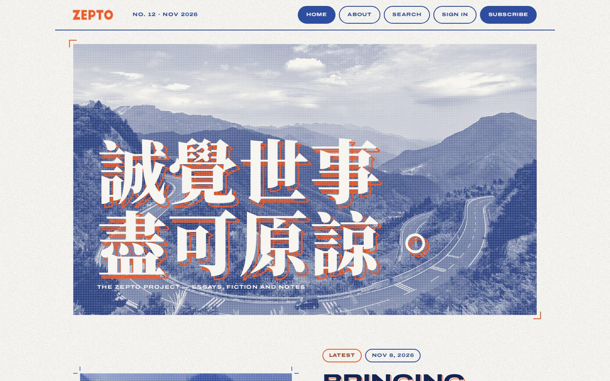
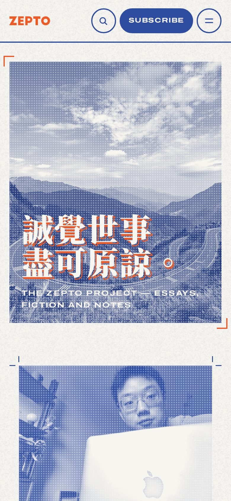
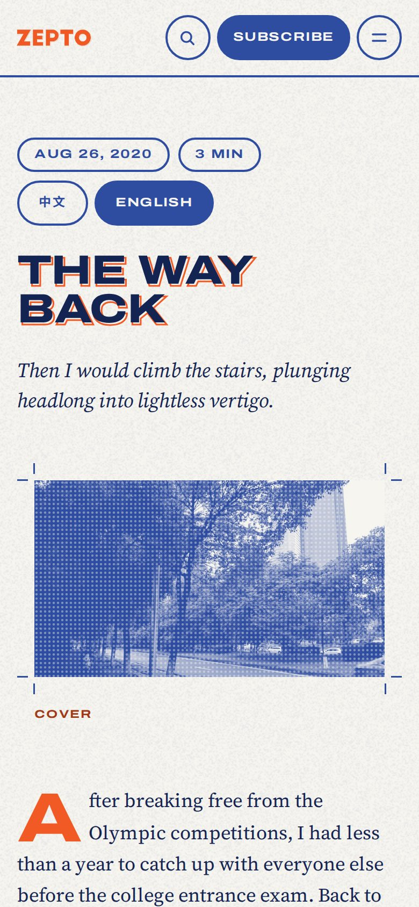
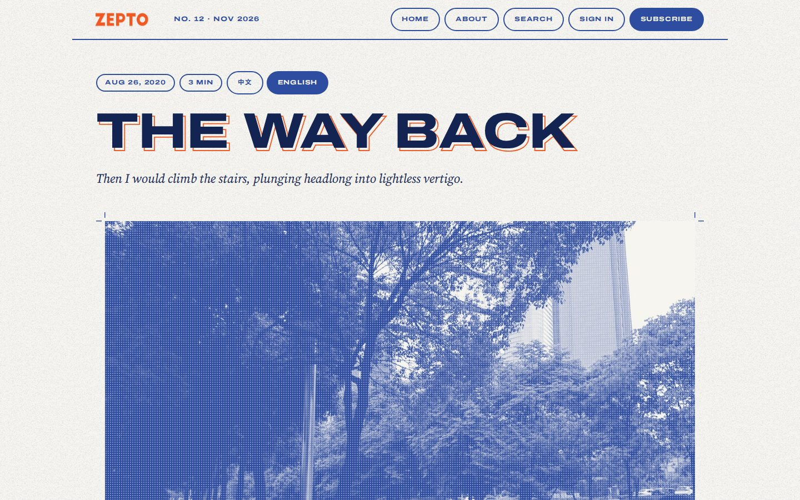
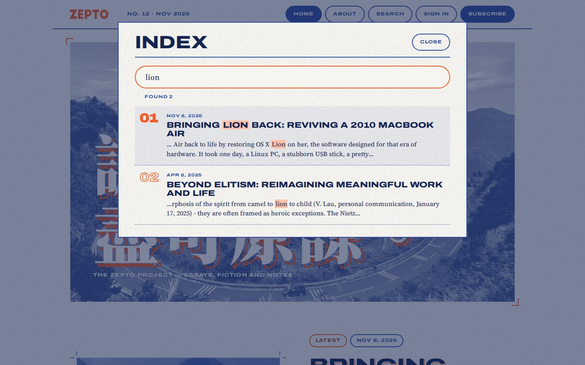
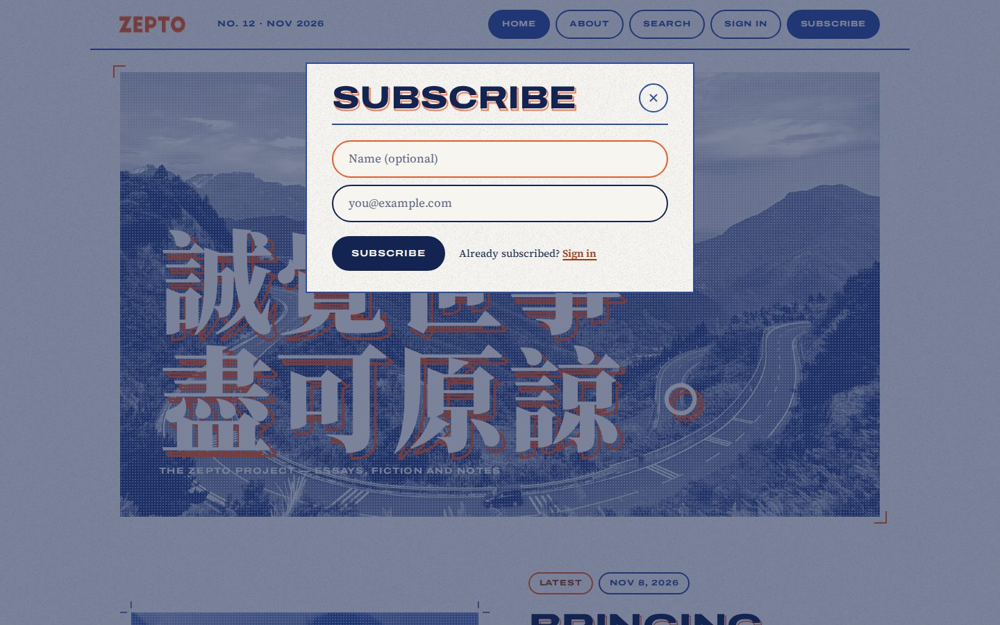

# Riso Press 油印

A Ghost theme printed in two inks. Photos print as risograph duotones on paper with a fine grain, titles carry an offset outline in the second ink as if the drums were slightly out of register, screenshots stay in full colour inside crop marks, and every post ends on a small square of ink. The front page prints your site description over the cover, then the newest post as the lead, then every other post numbered like back issues.



<p>


</p>



## Features

- Two inks, set in the theme settings, with every photo printed as a duotone
- Misregistered titles, crop marks, halftone dots and paper grain
- A Chinese site description set large over the cover, in two lines
- Search as a printed index; sign-in and subscribe on a matching sheet
- Bilingual 中文 / English posts with per-language reading time
- Below 980px, a compact bar with a numbered menu

## Install

1. Download `riso-press-1.0.0.zip` from the [latest release](https://github.com/XGZepto/riso-press/releases/latest).
2. In Ghost Admin, go to **Settings → Design & branding → Change theme → Upload theme** and choose the zip.
3. Activate it.

Requires Ghost 6.0 or later. Fonts load from Google Fonts.

## Writing for this theme

**Bilingual posts.** Write the Chinese version, insert a divider (the `---` card), then write the English version, and add the internal tag `#bilingual`. Readers get a 中文 / English switch and their choice is remembered; reading time is recalculated for the language they read. Without JavaScript, and in email and RSS, the post reads in full exactly as written. A first paragraph reading "(English version follows)" is hidden automatically.

**Simplified Chinese.** Tag a post `#zh-hans` to set it in Simplified character forms. Other Chinese text is detected automatically and set in Traditional forms.

**Chinese emphasis.** Italic Chinese is set in Chiron Sung HK italic.

**The front page** uses the site cover image and description (Settings → General). Without a cover image the masthead prints straight onto the paper; without a description, the site title is printed large.

## Search, sign-in and subscribe

- **Search** reads your posts through the Content API (with the RSS feed as a fallback) and searches titles, tags, excerpts and full text. Chinese is matched anywhere in the text; English matches at the start of words. Press `/` to open it.
- **Sign-in and subscribe** send Ghost's usual magic link. Ghost's own links, such as `#/portal/signup` in your navigation or the sign-in button in the comments box, open the theme's version too, and the confirmation after a magic link is shown in the theme's style.
- **Your membership settings decide what readers see.** On a site with free signup, Subscribe opens the theme's form. On sites with paid tiers, or where signup requires agreeing to terms, Subscribe opens Ghost's Portal so readers can choose a plan or accept the terms. On invite-only sites only Sign in is shown. The member account page uses Portal, and Portal's floating button is hidden.

<p> </p>

## Theme settings

In Ghost Admin → Settings → Design & branding → Theme:

| Setting | What it does |
| --- | --- |
| First ink | Text, rules and the shadows of every photo |
| Second ink | Offset outlines, drop caps, numbers and accents |
| Hero credit | The line after the site title on the front page |
| Default language | Which half a `#bilingual` post opens on: the reader's browser language, 中文 or English |

Custom fonts chosen in Ghost Admin (Settings → Design & branding → Brand) replace the theme's heading and body faces.

## Development

```bash
pnpm install
pnpm test      # gscan, Ghost's theme validator
pnpm zip       # dist/riso-press-<version>.zip, ready to upload
```

To work against a local Ghost, link this folder into its themes directory and activate it:

```bash
ln -s "$PWD" /path/to/ghost/content/themes/riso-press
```

`assets/css/screen.css` and the scripts in `assets/js/` are served as written. Search and the sign-in dialog run from `search.js` and `members.js`; how they look is set in `main.js`, the partials and the CSS.

## Credits

Typefaces from Google Fonts, all under the SIL Open Font License: Archivo, Source Serif 4, Noto Serif TC, Noto Serif SC, Noto Sans TC, Chiron Sung HK and JetBrains Mono. Built for [Ghost](https://ghost.org).

## License

[MIT](LICENSE)
